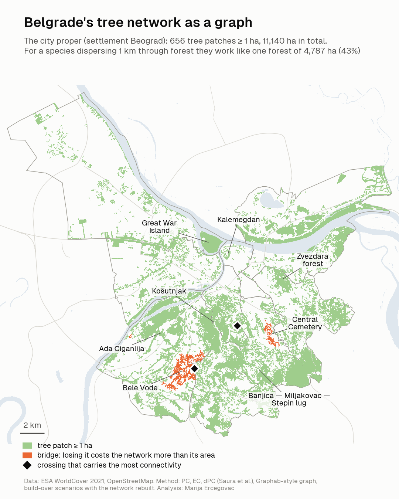
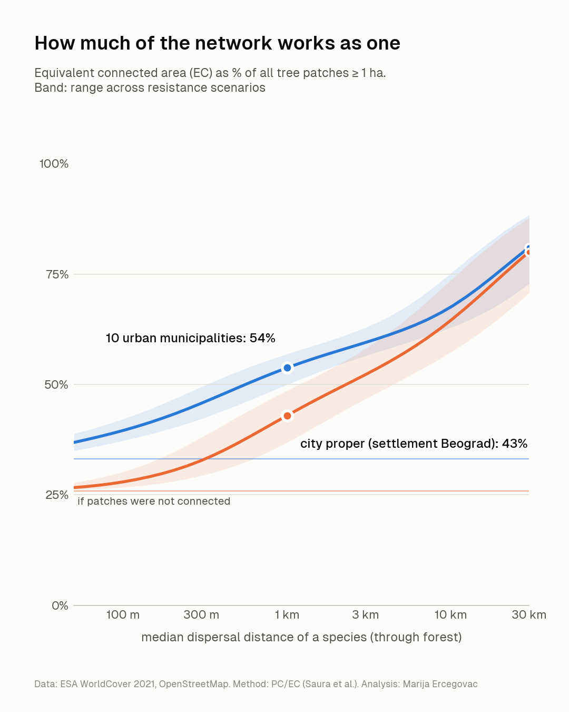
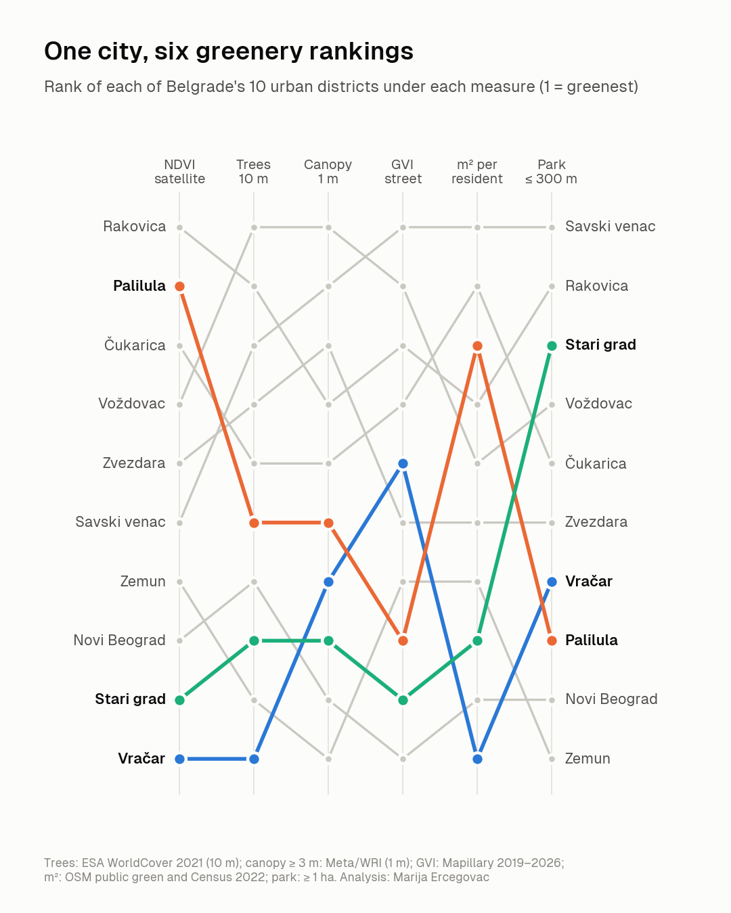
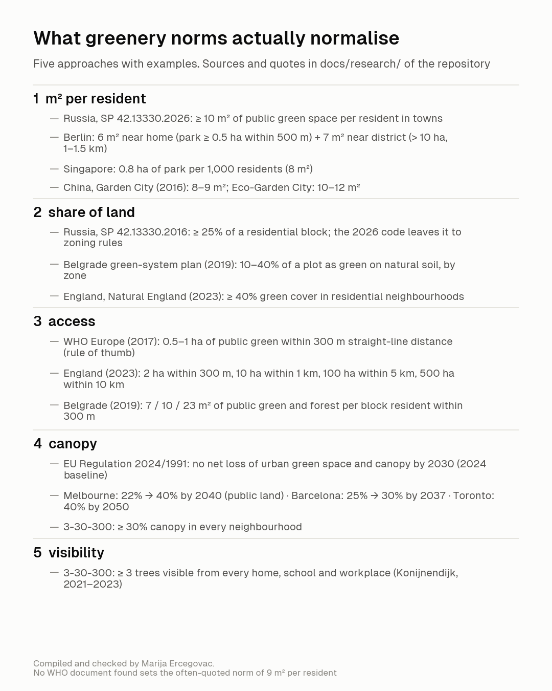

# Belgrade green

Two small open-data studies of urban greenery in Belgrade, Serbia.

1. **The tree network as a graph.** How much of the city's forest works as one network, which
   patches hold it together, and where it is squeezed.
2. **Five ways to measure greenery.** Satellite NDVI, 10 m tree cover, 1 m canopy, the street-level
   Green View Index and green space per resident rank the same ten districts differently.

Every number below is generated by the scripts (`make results`) and listed in
[docs/RESULTS.md](docs/RESULTS.md). Methods: [docs/methodology.md](docs/methodology.md).
Data and licences: [docs/DATA.md](docs/DATA.md).

## 1. The tree network as a graph



Tree patches of at least 1 ha (ESA WorldCover 2021) are the nodes; least-cost paths over a
resistance surface (land cover plus OSM roads and railways) are the links. Connectivity follows
Saura's Probability of Connectivity and its Equivalent Connected area (EC), for a generalist woodland
species with a median dispersal distance of 1 km through forest.

* In the city proper (settlement Beograd), **11,140 ha** of tree patches work
  like a single forest of **4,787 ha (43%)**;
  37% to 49% across resistance scenarios.
  For the 10 urban municipalities with their peri-urban forests: 54%.
* The Banjica - Miljakovac - Stepin lug forest belt holds the network: building it over costs
  50% of the city's EC (37% with whole patches).
* The strongest bridge is the Bele Vode forest (277 ha): building it over costs
  663 ha of EC, 2.4× its area
  (627 ha, 2.3×, with whole patches).
* The link between Bele Vode and the Banjica belt crosses one street (Vidikovački venac) and carries
  20% of the city's connectivity.
* The Košutnjak - Topčider - Dedinje forest and the Banjica forests are linked through a few narrow gaps;
  the narrowest carries 14% of the whole current in a single 10 m cell.



## 2. Five ways to measure greenery

The ten units are the parts of the settlement Beograd inside each urban municipality (Census 2022 population). Rank in brackets, 1 = greenest.



| District | Residents | NDVI (summer 2025) | Tree cover, WorldCover | Canopy ≥ 3 m, Meta | Green View Index | Public green, m²/resident | Residents ≤ 300 m from ≥ 1 ha park |
|---|---:|---:|---:|---:|---:|---:|---:|
| Novi Beograd | 209,763 | 0.37 (8) | 24% (7) | 14% (9) | 0.16 (10) | 16 (9) | 31% (9) |
| Zvezdara | 172,625 | 0.53 (5) | 47% (4) | 33% (3) | 0.20 (6) | 40 (6) | 55% (6) |
| Zemun | 166,049 | 0.45 (7) | 14% (9) | 9% (10) | 0.18 (7) | 25 (7) | 20% (10) |
| Voždovac | 155,909 | 0.53 (4) | 52% (1) | 38% (1) | 0.22 (2) | 54 (5) | 66% (4) |
| Čukarica | 138,187 | 0.54 (3) | 42% (5) | 23% (5) | 0.21 (4) | 88 (2) | 55% (5) |
| Palilula | 113,883 | 0.55 (2) | 35% (6) | 23% (6) | 0.17 (8) | 78 (3) | 36% (8) |
| Rakovica | 104,456 | 0.57 (1) | 51% (2) | 30% (4) | 0.22 (3) | 69 (4) | 75% (2) |
| Vračar | 55,406 | 0.26 (10) | 10% (10) | 18% (7) | 0.20 (5) | 2 (10) | 45% (7) |
| Stari grad | 44,737 | 0.28 (9) | 19% (8) | 18% (8) | 0.17 (9) | 18 (8) | 70% (3) |
| Savski venac | 36,699 | 0.46 (6) | 50% (3) | 36% (2) | 0.25 (1) | 89 (1) | 79% (1) |



## Reproduce

```bash
pip install -r requirements.txt   # torch and transformers only for the Green View Index
make data          # downloads into data/raw (Overpass, AWS, Earth Search, JRC, Hugging Face)
make connectivity  # Part 1, about 30 min on a laptop
make measures      # Part 2 without the street-level index
make gvi           # needs a Mapillary client token in ~/.mapillary_token
make figures results test
```

## Licence

Code: MIT ([LICENSE](LICENSE)). Text and figures: CC BY 4.0 ([LICENSE-CONTENT](LICENSE-CONTENT)).
Input data keep their own licences, see [docs/DATA.md](docs/DATA.md). Map data © OpenStreetMap contributors.
